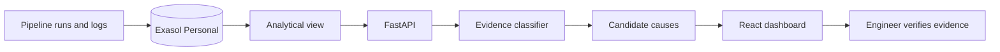

# OpsIntel AI

**Evidence-based data pipeline investigation powered by Exasol Personal**

> ExaThon India 2026 · Track 04: The Work Behind the Work

[](https://github.com/Anafa-thabassum/opsintel-ai/actions/workflows/ci.yml)
[](LICENSE)

On-call data engineers cannot quickly determine why overnight pipelines failed
because run metadata, row-count discrepancies, and logs are scattered across
systems. OpsIntel AI brings this evidence together in Exasol and presents
traceable candidate explanations, giving engineers a focused starting point
without claiming an unverified root cause.

## Project status

Working hackathon prototype:

- Exasol-backed incident retrieval and historical analytics.
- FastAPI investigation API.
- Rule-based, evidence-first failure classification.
- React dashboard with real Exasol telemetry.
- 45 automated tests and a 16-case synthetic challenge set.
- Reproducible Exasol benchmark over one million synthetic pipeline runs.

Root causes are never automatically confirmed. The system reports observations,
candidate explanations, limitations, and the next diagnostic action.


The investigation view keeps database observations separate from candidate
causes and leaves the confirmed root cause unset until a person verifies it.

## Submission assets

| Asset | Status |
|---|---|
| Public source repository | Available |
| MIT licence | Available |
| Reproducible run guide | Available below |
| Pitch deck | Available in `submission/` |
| Three-minute demo script | Available in `docs/demo-script.md` |
| Recorded demo video | Record and upload before submission |

## What the prototype does

1. Retrieves failed or incomplete pipeline runs from Exasol.
2. Calculates historical completeness and rolling failure features in Exasol.
3. Collects the selected run's log evidence.
4. Classifies timeout, schema, dependency, early-termination, incomplete-data,
   and unknown evidence.
5. Produces candidate causes and safe investigation steps.
6. Presents every observation and its database source in the dashboard.

## Why Exasol

Exasol is the analytical core rather than a passive record store. The
`OPSINTEL.PIPELINE_HEALTH_FEATURES` view uses analytical window functions to
calculate:

- previous pipeline status with `LAG`;
- rolling actual-row baselines;
- rolling failure rates;
- missing-row counts and completeness percentages;
- daily incident telemetry consumed by the dashboard.

The sample history establishes a healthy baseline before the four demonstration
incidents, allowing the UI to show an actual operational trend.

## Architecture



## AI scope and safety

The current classifier is deterministic and rule-based. “AI-assisted” describes
the investigation workflow and planned evolution; it is not a claim that a
trained model or external LLM is currently integrated.

The deliberate safety boundary is:

- database observations are facts;
- explanations are candidates;
- confirmed root cause remains `null` until independently verified;
- no automated repair is executed.

## Technology

| Component | Technology |
|---|---|
| Analytical database | Exasol Personal |
| Backend | Python and FastAPI |
| Database client | PyExasol |
| Frontend | React, Vite and Recharts |
| Verification | pytest, Oxlint and GitHub Actions |

## Repository structure

```text
opsintel-ai/
├── app/                         # API, database access and investigation logic
├── docs/                        # Demo, Q&A and submission guidance
├── evaluation/                  # Independent holdout runner template
├── frontend/                    # React dashboard
├── reports/
│   ├── evaluation.md            # Reproducible evaluation summary
│   └── exasol-benchmark.json    # Raw local scale measurement
├── scripts/setup_database.py    # Demo database setup command
├── sql/
│   ├── schema.sql
│   ├── seed.sql
│   └── analysis/
│       └── pipeline_health_features.sql
├── tests/
├── .env.example
├── LICENSE
├── requirements.txt
└── README.md
```

## Run locally

### Requirements

- Python 3.12 or newer. The current development environment uses Python 3.14.
- Node.js 20 or newer.
- Exasol Personal running locally or at an accessible endpoint.

### 1. Clone and install the backend

```bash
git clone https://github.com/Anafa-thabassum/opsintel-ai.git
cd opsintel-ai
python3 -m venv .venv
source .venv/bin/activate
python -m pip install -r requirements.txt
```

### 2. Configure Exasol

The defaults connect to Exasol Personal at `127.0.0.1:8563` and read its local
deployment password from:

```text
~/.exasol/personal/deployments/default/secrets.json
```

For another deployment, export the variables documented in `.env.example`:

```bash
export EXASOL_DSN="127.0.0.1:8563"
export EXASOL_USER="sys"
export EXASOL_PASSWORD="your-local-password"
export EXASOL_TLS_VERIFY="false"
```

Do not commit passwords or secret files. Certificate verification should be
enabled for non-local deployments.

### 3. Initialize the synthetic demo database

```bash
python -m scripts.setup_database
```

If an older synthetic `OPSINTEL` schema already exists and may be safely
discarded:

```bash
python -m scripts.setup_database --reset
```

`--reset` drops only the synthetic `OPSINTEL` schema before recreating it.

### 4. Start the backend

```bash
uvicorn app.main:app --reload
```

Verify:

```bash
curl http://127.0.0.1:8000/health
curl http://127.0.0.1:8000/analytics/trend
```

Interactive API documentation is available at `http://127.0.0.1:8000/docs`.

### 5. Start the dashboard

In a second terminal:

```bash
cd frontend
cp .env.example .env
npm ci
npm run dev
```

Open `http://127.0.0.1:5173`.

## API

| Method | Endpoint | Purpose |
|---|---|---|
| GET | `/` | Service identity |
| GET | `/health` | Lightweight database connectivity check |
| GET | `/incidents` | Failed or incomplete runs |
| GET | `/analytics/trend` | Exasol-calculated daily telemetry |
| GET | `/investigate/{run_id}` | Evidence, classification and candidates |
| GET | `/investigate/{run_id}/root-causes` | Candidate causes only |

## Verification

Backend:

```bash
python -m pytest -q
python -m tests.run_evaluation
python -m scripts.benchmark_exasol
```

Frontend:

```bash
cd frontend
npm run lint
npm run build
```

Latest verified results:

- **45/45 automated tests passed**.
- **16/16 predefined synthetic challenge cases classified correctly**.
- **1,000,000 synthetic Exasol runs queried in 473.209 ms median and
  503.947 ms p95** across seven local repetitions.
- **Frontend lint passed with no warnings**.
- **Frontend production build passed**.

These results demonstrate reproducibility on the included synthetic scenarios
and a local, single-user analytical benchmark; they are not production
accuracy, throughput, or concurrency claims. See
[`reports/evaluation.md`](reports/evaluation.md) and the raw
[`benchmark result`](reports/exasol-benchmark.json).

An external evaluator can create unseen cases from
[`evaluation/holdout_template.csv`](evaluation/holdout_template.csv) and run
them against a frozen commit with `python -m scripts.evaluate_holdout`. No
independent score is claimed until that process is completed.

## Demonstration scenarios

| Pipeline | Evidence category |
|---|---|
| Daily sales import | Early termination |
| Customer sync | Timeout |
| Product catalog | Schema mismatch |
| Daily reporting | Upstream dependency failure |

## Known limitations

- Data and logs are synthetic.
- The challenge set is small and predefined.
- Classification uses transparent rules rather than semantic language models.
- Production concurrency and real orchestrator integration have not been
  established.
- Human productivity impact remains unmeasured; the preregistered protocol is
  in [`reports/impact-study-protocol.md`](reports/impact-study-protocol.md).
- Recommendations are diagnostic suggestions, not executed repairs.

## Licence

Licensed under the [MIT Licence](LICENSE).

---

**OpsIntel AI — Follow the evidence. Investigate faster. Confirm carefully.**
