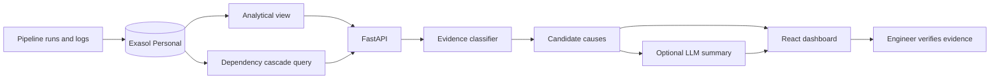

# OpsIntel AI

**Evidence-based data pipeline investigation powered by Exasol Personal**

> ExaThon India 2026 · Track 04: The Work Behind the Work

[](https://github.com/Anafa-thabassum/opsintel-ai/actions/workflows/ci.yml)
[](LICENSE)

On-call data engineers cannot quickly determine why overnight pipelines failed
because run metadata, row-count discrepancies, and logs are scattered across
systems. OpsIntel AI brings this evidence together in Exasol and presents
traceable candidate explanations, giving engineers a focused starting point
without claiming an unverified root cause.

## Project status

Working hackathon prototype:

- Exasol-backed incident retrieval and historical analytics.
- FastAPI investigation API.
- Rule-based, evidence-first failure classification.
- Optional LLM narrative summary grounded in the retrieved evidence.
- React landing page and dashboard with real Exasol telemetry.
- 71 automated tests and a 16-case synthetic challenge set.
- Reproducible Exasol benchmark over one million synthetic pipeline runs.

Root causes are never automatically confirmed. The system reports observations,
candidate explanations, limitations, and the next diagnostic action.


The investigation view keeps database observations separate from candidate
causes and leaves the confirmed root cause unset until a person verifies it.

## Submission assets

| Asset | Status |
|---|---|
| Public source repository | Available |
| MIT licence | Available |
| Reproducible run guide | Available below |
| Pitch deck PDF and PPTX | Available in `submission/` |
| Three-minute demo script | Available in `docs/demo-script.md` |
| Recorded demo video | Existing 2:34 draft must be re-recorded after the final Exasol reset |

## What the prototype does

1. Retrieves failed or incomplete pipeline runs from Exasol.
2. Calculates historical completeness and rolling failure features in Exasol.
3. Collects the selected run's log evidence.
4. Classifies timeout, schema, dependency, early-termination, incomplete-data,
   delayed, duplicate, conflicting, and unknown evidence.
5. Produces candidate causes and safe investigation steps.
6. Optionally summarizes the same evidence and lists what is still missing.
7. Presents timestamps, source references, recent run history, and a safe
   engineer-review state in the dashboard.

## Why Exasol

Exasol is the analytical core rather than a passive record store. The
`OPSINTEL.PIPELINE_HEALTH_FEATURES` view uses analytical window functions to
calculate:

- previous pipeline status with `LAG`;
- rolling actual-row baselines;
- rolling failure rates;
- missing-row counts and completeness percentages;
- daily incident telemetry consumed by the dashboard.
- cross-pipeline failure cascades calculated with Exasol `CONNECT BY`.

The sample history establishes a healthy baseline before eleven representative
incident scenarios, allowing the UI to show an operational trend and exercise
every investigation outcome.

## Architecture



## AI scope and safety

The classifier and candidate generation remain deterministic and rule-based.
An optional OpenAI Responses API step can turn the retrieved evidence and
candidates into a concise narrative and a list of evidence gaps. Every factual
claim must cite one or more retrieved run or log references; the integration
rejects the entire model response when any claim uses an unknown reference. It
is disabled by default and does not replace or modify the deterministic
assessment. The configured `gpt-6-luna` model ID is listed in the
[official OpenAI model catalog](https://developers.openai.com/api/docs/models/gpt-6-luna).

The deliberate safety boundary is:

- database observations are facts;
- explanations are candidates;
- confirmed root cause remains `null` until independently verified;
- the LLM output is labelled as a narrative summary only;
- no automated repair is executed.

## Technology

| Component | Technology |
|---|---|
| Analytical database | Exasol Personal |
| Backend | Python and FastAPI |
| Database client | PyExasol |
| Optional summarizer | OpenAI Responses API through HTTPX |
| Local analytical baseline | DuckDB 1.5.6 |
| Frontend | React, Vite and Recharts |
| Verification | pytest, Oxlint and GitHub Actions |

## Repository structure

```text
opsintel-ai/
├── app/                         # API, database access and investigation logic
├── docs/                        # Demo, Q&A and submission guidance
├── evaluation/                  # Frozen and external-reviewer holdout data
├── frontend/                    # React dashboard
├── reports/
│   ├── evaluation.md            # Reproducible evaluation summary
│   └── exasol-benchmark.json    # Raw local scale measurement
├── scripts/setup_database.py    # Demo database setup command
├── examples/integrations/       # Airflow and dbt exported-JSON samples
├── submission/                  # Pitch deck, PDF and demo video
├── sql/
│   ├── schema.sql
│   ├── seed.sql
│   └── analysis/
│       └── pipeline_health_features.sql
├── tests/
├── .env.example
├── Makefile                     # One-command setup and verification
├── LICENSE
├── requirements.txt
└── README.md
```

## Run locally

### Requirements

- Python 3.12 or newer. The current development environment uses Python 3.14.
- Node.js 20 or newer.
- Exasol Personal running locally or at an accessible endpoint.

For a one-command dependency setup after cloning:

```bash
make setup
```

### 1. Clone and install the backend

```bash
git clone https://github.com/Anafa-thabassum/opsintel-ai.git
cd opsintel-ai
python3 -m venv .venv
source .venv/bin/activate
python -m pip install -r requirements.txt
```

### 2. Configure Exasol

The defaults connect to Exasol Personal at `127.0.0.1:8563` and read its local
deployment password from:

```text
~/.exasol/personal/deployments/default/secrets.json
```

For another deployment, export the variables documented in `.env.example`:

```bash
export EXASOL_DSN="127.0.0.1:8563"
export EXASOL_USER="sys"
export EXASOL_PASSWORD="your-local-password"
export EXASOL_TLS_VERIFY="false"
```

Do not commit passwords or secret files. Certificate verification should be
enabled for non-local deployments.

To enable the optional LLM summary, set these backend-only variables:

```bash
export OPSINTEL_LLM_ENABLED="true"
export OPENAI_API_KEY="your-openai-api-key"
export OPSINTEL_LLM_MODEL="gpt-6-luna"
```

If the feature is disabled or the model request fails, the endpoint still
returns the complete deterministic investigation. Never expose the API key to
the React frontend.

### 3. Initialize the synthetic demo database

```bash
python -m scripts.setup_database
```

If an older synthetic `OPSINTEL` schema already exists and may be safely
discarded:

```bash
python -m scripts.setup_database --reset
```

`--reset` drops only the synthetic `OPSINTEL` schema before recreating it.

### 4. Start the backend

```bash
python -m uvicorn app.main:app --reload
```

Verify:

```bash
curl http://127.0.0.1:8000/health
curl http://127.0.0.1:8000/analytics/trend
```

Interactive API documentation is available at `http://127.0.0.1:8000/docs`.

### 5. Start the dashboard

In a second terminal:

```bash
cd frontend
cp .env.example .env
npm ci
npm run dev
```

Open `http://127.0.0.1:5173`.

The landing page links to a judge-facing demo-access screen before the
dashboard. This creates only a temporary browser session; it is intentionally
labelled as a demo gate and is not production authentication.

For a hosted build, see [`docs/deployment.md`](docs/deployment.md).

## API

| Method | Endpoint | Purpose |
|---|---|---|
| GET | `/` | Service identity |
| GET | `/health` | Lightweight database connectivity check |
| GET | `/incidents` | Failed or incomplete runs |
| GET | `/analytics/trend` | Exasol-calculated daily telemetry |
| GET | `/analytics/cascades` | Upstream/downstream failure correlations |
| GET | `/investigate/{run_id}` | Evidence, candidates and optional LLM summary |
| GET | `/investigate/{run_id}/root-causes` | Candidate causes only |

## Verification

Run the complete backend, regression, lint, and build verification:

```bash
make verify
```

Backend:

```bash
python -m pytest -q
python -m tests.run_evaluation
python -m scripts.exasol_proof
python -m scripts.benchmark_exasol
```

Frontend:

```bash
cd frontend
npm run lint
npm run build
```

Latest verified results:

- **71/71 automated tests passed**.
- **16/16 predefined synthetic challenge cases classified correctly**.
- **27/27 frozen synthetic holdout cases classified correctly** across all
  nine outcomes.
- **1,000,000 synthetic Exasol runs queried in 473.209 ms median and
  503.947 ms p95** across seven local repetitions.
- **Frontend lint passed with no warnings**.
- **Frontend production build passed**.

With Exasol Personal running, `make exasol-proof` prints the actual historical
completeness rows and timestamped log evidence used by the demo investigation.
Keep that output with the benchmark record when preparing the judging demo.

These results demonstrate reproducibility on the included synthetic scenarios
and a local, single-user analytical benchmark; they are not production
accuracy, throughput, or concurrency claims. See
[`reports/evaluation.md`](reports/evaluation.md) and the raw
[`benchmark result`](reports/exasol-benchmark.json).

The [`judging evidence map`](reports/judging-scorecard.md) links each published
criterion to a concrete file or demo moment.

The separate [`frozen synthetic holdout`](evaluation/frozen_holdout_v1.csv)
contains 27 versioned cases and a published
[`result report`](reports/frozen-holdout-v1.md). Reproduce it with
`make holdout`. The project team authored this dataset, so its 27/27 result is
not an independent or production accuracy claim.

Two or three external reviewers can create 15–20 genuinely unseen cases from
[`evaluation/holdout_template.csv`](evaluation/holdout_template.csv). After
committing and tagging the completed data, run:

```bash
make independent-holdout \
  FILE=evaluation/independent_holdout_v1.csv \
  REF=independent-holdout-v1
```

The evaluator verifies the tagged dataset and classifier hashes, requires two
or three pseudonymous case-author IDs, and publishes JSON plus Markdown error
analysis. No independent score is claimed until external reviewers complete
that process.

The [human-impact study protocol](reports/impact-study-protocol.md) now includes
ten frozen cases and a counterbalanced 40-trial assignment for four
pseudonymous participants. Load its cases into Exasol with
`make impact-study-database`, keep the LLM disabled, record the assigned trials
in [`evaluation/impact_template.csv`](evaluation/impact_template.csv), then run:

```bash
make impact \
  FILE=/path/to/impact-results.csv \
  RECRUITMENT=/path/to/recruitment.md
```

The summarizer verifies the frozen assignment, derives outcomes from the hidden
case key, records hashes and the tested commit, and reports time, agreement,
traceability, confidence, and unsafe-certainty events. No productivity result
is claimed until four real participants complete the study.

## Comparative database benchmark

`make benchmark-compare` runs the same window-analytics and daily-aggregation
workload on Exasol Personal and DuckDB at one million and ten million rows. The
repository currently includes a measured
[`DuckDB baseline`](reports/duckdb-baseline.json) and an
[`editable SVG chart`](reports/duckdb-baseline.svg). A complete engine comparison
is not claimed until the command records both engines in
`reports/database-comparison.json` on the same machine.

This comparison is local and single-user. It tests query latency, not
concurrency, distributed scale, operational cost, or production reliability.
Exasol remains central because shared pipeline history, window features, log
evidence, and dependency cascades stay queryable inside the operational
analytical database instead of being extracted into the API process.

## Airflow and dbt import sample

The [`exported-JSON adapter`](examples/integrations/README.md) normalizes sample
Airflow DAG runs and dbt `run_results` records into OpsIntel's run and log
schema. Previewing is read-only; `--apply` must be supplied before the adapter
writes to Exasol. This is an integration example, not a live orchestrator
connector.

## Demonstration scenarios

| Pipeline | Evidence category |
|---|---|
| Daily sales import | Early termination |
| Customer sync | Timeout |
| Product catalog | Schema mismatch |
| Daily reporting | Upstream dependency failure |
| Late file ingest | Delayed run |
| Partial orders load | Incomplete data |
| Billing retry | Duplicate or excess data |
| Warehouse publish | Conflicting evidence |
| Partner feed | Unclassified messy log |
| Customer orders and billing export | Downstream dependency cascade |

## Known limitations

- Data and logs are synthetic.
- The challenge set is small and predefined.
- Classification uses transparent rules rather than semantic language models.
- Production concurrency and live orchestrator connectivity have not been
  established; the repository includes exported-JSON adapter samples only.
- Human productivity impact remains unmeasured; the frozen cases,
  counterbalanced assignment, prefilled recording template, and result summarizer
  are ready for a real four-participant study.
- Recommendations are diagnostic suggestions, not executed repairs.

## Licence

Licensed under the [MIT Licence](LICENSE).

---

**OpsIntel AI — Follow the evidence. Investigate faster. Confirm carefully.**
