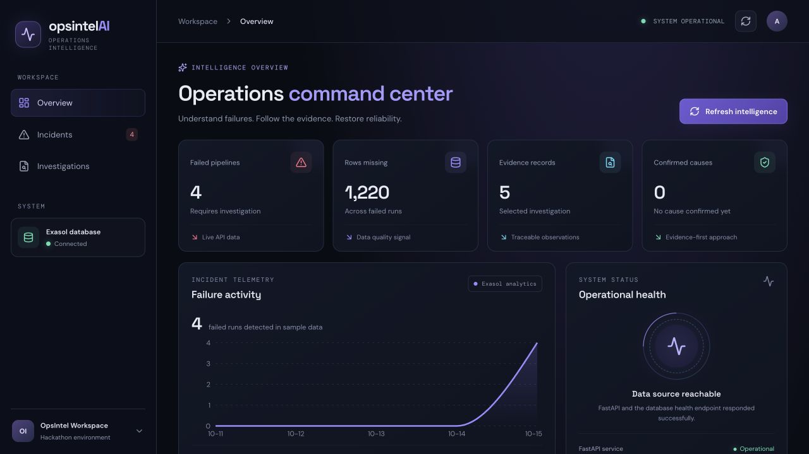

# OpsIntel AI

**Follow pipeline evidence from Exasol to a human-reviewed incident hypothesis.**

OpsIntel helps data engineers investigate failed runs using source-linked logs, row counts, and pipeline history. It separates observed symptoms from candidate causes and leaves confirmation to an authorized reviewer.

**Start here:** [Quickstart](docs/QUICKSTART.md) · [Live demo approach](docs/demo-script.md) · [Evaluation limits](reports/reproducibility-and-evaluation.md)

[](https://github.com/Anafa-thabassum/opsintel-ai/actions/workflows/ci.yml)
[](LICENSE)

## Problem statement

**Track 04 — The Work Behind the Work**

Data engineers and data-platform teams are responsible for maintaining reliable data pipelines that support analytics, dashboards, finance, and business operations.

When pipelines fail overnight or deliver incomplete data, engineers often have to manually investigate fragmented execution metadata, row counts, logs, and upstream dependencies to identify what went wrong.

Although monitoring tools can detect pipeline failures, understanding the underlying causes still requires engineers to correlate evidence across multiple sources. This delays diagnosis, makes investigations difficult to reproduce, and causes operational knowledge to remain scattered across individuals and incident records.

OpsIntel AI addresses this problem by bringing operational evidence into one structured investigation workflow, producing traceable candidate explanations, and retaining causes only after authorized human review.

**Primary users:** On-call data engineers and data-platform teams.

**Why it matters:** Pipeline failures and incomplete data can delay downstream analytics, dashboards, finance reporting, and business decisions.

## What it does

- **Connects operational evidence:** Exasol calculates run completeness, rolling history, and time-correlated dependency paths.
- **Keeps investigations traceable:** deterministic rules report supported symptoms, cite evidence, surface gaps, and abstain when evidence is insufficient.
- **Governs incident memory:** an investigator proposes a cause; a different authorized reviewer checks the evidence; Exasol stores approved records and audit history. Later matches are candidates. FastAPI computes similarity, which is not a probability or confirmation.

The optional public-issue explorer is separate from the synthetic demo telemetry. Its category labels are project-assigned, not independent adjudications.



*Screenshot captured from the running local dashboard on October 31, 2026. Pipeline metrics and incident history shown here are synthetic demo telemetry; public incident examples are separate and identified in Public Data.*

## Why Exasol

Exasol is used for the analytical work, not just as a persistence layer. The `OPSINTEL.PIPELINE_HEALTH_FEATURES` view computes completeness, prior status, rolling row baselines, and rolling failure rates with window functions. A `CONNECT BY` query traverses dependency relationships. Exasol also stores submissions, confirmations, evidence features, candidate matches, and audit events. Fingerprinting and similarity scoring run in Python.

The demo pipeline history is synthetic and is clearly separate from the public issue corpus. See [architecture](docs/ARCHITECTURE.md) and [Exasol setup](docs/EXASOL_SETUP.md).

## Quickstart

### Prerequisites

- Exasol Personal running locally, or a reachable Exasol service. Local defaults use `127.0.0.1:8563`.
- Python 3.12 or newer. CI uses Python 3.12; the latest local verification used Python 3.14.
- Node.js 20.19+ or 22.12+; CI uses Node 20. Install the frontend dependencies from the lockfile.

### Install and start

```bash
git clone https://github.com/Anafa-thabassum/opsintel-ai.git
cd opsintel-ai
make setup
```

Start Exasol Personal using its application or, when its CLI is installed:

```bash
exasol start --wait-timeout-minutes 3
```

Configure the backend environment from `.env.example` (the Python app does not automatically load a `.env` file):

```bash
cp .env.example .env
set -a
source .env
set +a
```

The local Exasol password can come from Exasol Personal's default secrets file. Otherwise set `EXASOL_PASSWORD` in your shell or secret manager. Then prepare the synthetic demo schema and start the API:

```bash
make database
make memory-migrate
make api
```

In a second terminal:

```bash
cd frontend
cp .env.example .env
npm ci
npm run dev
```

Open <http://127.0.0.1:5173>. Verify the API and try an existing demo incident:

```bash
curl http://127.0.0.1:8000/health
curl http://127.0.0.1:8000/investigate/1
```

`make database` creates and seeds synthetic demo tables only when `OPSINTEL` is absent; it does not replace an existing schema. `make memory-migrate` applies additive migrations. Do not use `make database-reset` or `make smoke` except against a disposable database you are authorized to reset. See [Installation](docs/INSTALLATION.md) and [Troubleshooting](docs/TROUBLESHOOTING.md).

## Verified Incident Memory status

The existing MP4 is a historical 2:34 recording and does not show the current Verified Incident Memory workflow. The Exasol-backed API workflow was exercised end to end with public Airflow issue evidence and temporary **test-only** identities. The test approval was later revoked through the audited endpoint. It verified persistence, retrieval, and a one-winner concurrent review transition; it did **not** verify a real authorized human decision. The only current live-memory performance measurement is an empty-history query (0 active memories): median 51.627 ms and p95 64.753 ms over 30 requests. It is not a scale benchmark. Human review and increasing-history measurements remain outstanding.

See the [memory workflow](docs/VERIFIED_INCIDENT_MEMORY.md), [rehearsal checklist](docs/verified-incident-memory-browser-rehearsal.md), and [runtime evidence](reports/exasol-memory-e2e-2026-10-31.md).

## Evaluation and measured evidence

These results answer different questions and must not be combined into one accuracy score.

| Evidence | Result | Provenance and limit |
|---|---:|---|
| Automated suite | 200/200 automated tests passed | Latest GitHub Actions run on 2026-10-31; the current pytest suite, evaluation, frontend lint, and production build passed. |
| Classifier challenge | 16/16 | Predefined synthetic challenge; regression evidence, not production accuracy. |
| Project-authored holdout | 27/27 | Synthetic, project-authored; not independent. |
| Frozen reviewer holdout | 4/19 (21.1%) | Three pseudonymous reviewer authors; frozen historical result; 15 wrong labels and 16 unresolved outputs. |
| Public compatibility corpus V1 | 6/9 | Project-mapped framework messages; historical compatibility result. |
| Public issue corpus V2 | 7/10 | Project-assigned taxonomy mappings; not independent adjudication. |
| Exasol/DuckDB analytical comparison | DuckDB faster in recorded 1M and 10M runs | Synthetic workload, seven runs per engine, local single-user environment. At 10M rows: DuckDB median 1,080.358 ms; Exasol median 4,902.269 ms. |
| Memory lookup | 51.627 ms median, 64.753 ms p95 | Zero-active-history baseline only; not evidence of scaling or performance improvement. |

Frozen evaluation files and historical reports remain unchanged. Dataset hashes, exact methods, benchmark samples, label provenance, and limitations are in the [reproducibility report](reports/reproducibility-and-evaluation.md) and the linked source reports. No participant study or real-human memory confirmation is claimed.

## Documentation

- [Quickstart](docs/QUICKSTART.md) · [Installation](docs/INSTALLATION.md) · [Configuration](docs/CONFIGURATION.md)
- [Architecture](docs/ARCHITECTURE.md) · [Data flow](docs/DATA_FLOW.md) · [Incident investigation](docs/INCIDENT_INVESTIGATION.md)
- [Exasol setup](docs/EXASOL_SETUP.md) · [Verified Incident Memory](docs/VERIFIED_INCIDENT_MEMORY.md) · [API reference](docs/API_REFERENCE.md)
- [Troubleshooting](docs/TROUBLESHOOTING.md) · [Security](docs/SECURITY.md) · [Contributing](CONTRIBUTING.md) · [Changelog](CHANGELOG.md)
- [Evaluation methodology](docs/evaluation-methodology.md) · [Public data provenance](docs/public-data-provenance.md) · [Demo script](docs/demo-script.md)
- [Deployment guide](docs/deployment.md)

  
## Hackathon submission

- **Track:** Track 04 — The Work Behind the Work
- **Source code:** This public GitHub repository
- **Pitch deck (PPTX):** [Download PPTX](submission/your-final-deck.pptx)
- **Pitch deck (PDF):** [Download PDF](submission/your-final-deck.pdf)
- **Demo video:** [Watch demonstration](submission/your-final-demo.mp4)
- **Setup:** [Quickstart](docs/QUICKSTART.md)
- **Deployment:** [Deployment guide](docs/deployment.md)
- **License:** MIT.

## Known limitations

- Demo pipeline records are synthetic; public issue excerpts are short and have project-assigned labels unless explicitly stated otherwise.
- The frozen reviewer holdout is only 19 cases and scored 4/19. The classifier is deterministic and can abstain on unfamiliar wording.
- Cause-specific review criteria are approved design policies, not empirically validated causal tests.
- No real incident has yet been approved and retained by an authorized human reviewer. Browser rehearsal, participant study, and increasing-history memory benchmarking remain outstanding.
- The one-million and ten-million row comparisons are local, synthetic, single-user workloads; they do not establish distributed performance or production cost.
- The email demo gate is not authentication. Most investigation endpoints do not require a token; do not expose this prototype to an untrusted network or use sensitive production logs.

## License and contribution

OpsIntel AI is licensed under the [MIT License](LICENSE). Read [CONTRIBUTING.md](CONTRIBUTING.md) before opening a pull request. Report security issues privately using the GitHub security advisory process described in [SECURITY.md](SECURITY.md).
