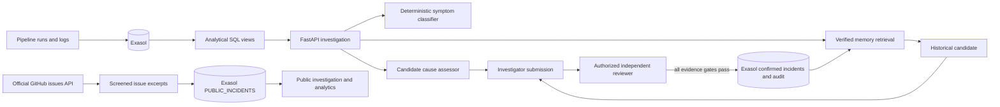

# OpsIntel architecture

OpsIntel keeps observations, classifier output, historical retrieval, reviewer decisions, and incident lifecycle separate.

The classifier describes supported symptoms and abstains on insufficient or conflicting evidence. It never confirms a cause. A verified memory match is a candidate based on a past human-reviewed record; its score is a retrieval similarity, not a probability. A reviewer can approve only a source-backed hypothesis with a complete cause-specific checklist and no unresolved classifier conflict. Lifecycle status remains a separate concept.

Exasol computes pipeline health features, rolling status/count comparisons, dependency paths, and memory operational aggregates. The application normalizes logs, calculates token-pair Jaccard similarity, applies contradiction penalties, and enforces reviewer workflow. See [Exasol integration](exasol-integration.md) and [memory design](verified-incident-memory.md).

The database memory workflow requires an additive migration and configured engineer tokens. The migration and a rollback-only SQL workflow were verified against the local Exasol Personal deployment; no human-confirmed incident was retained. Without Exasol Personal, the existing read-only public scorecard remains usable; live investigation and verified memory remain unavailable.

The public mode is separate from synthetic pipeline telemetry and verified
memory. It caches short, screened excerpts from real GitHub issues in Exasol,
retains source URLs, timestamps and body hashes, and shows deterministic symptom
classification with unresolved outcomes. The source-linked scorecard remains
available offline without Exasol; the new searchable public investigation
requires the additive migration and one-time ingestion.
