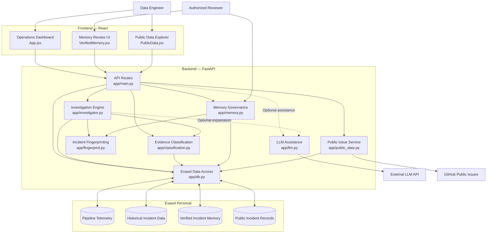
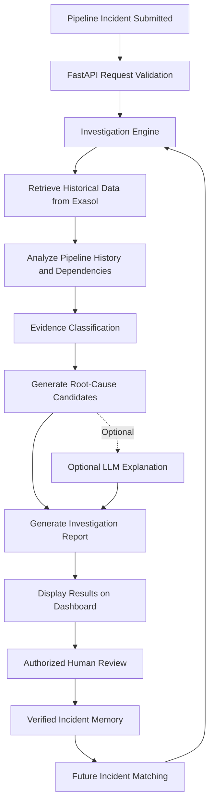

# OpsIntel AI — System Architecture

> **Evidence-Based Data Pipeline Incident Investigation and Recovery Platform powered by Exasol Personal**

## 1. Overview

OpsIntel AI is an intelligent incident investigation platform designed to help data engineers identify, understand, and investigate failed data pipelines.

The system combines historical pipeline telemetry, analytical SQL, evidence classification, verified incident memory, optional LLM-assisted explanations, and public issue intelligence to produce evidence-backed investigation results.

The architecture follows five stages:

**Detect → Investigate → Explain → Recommend → Learn**

The system prioritizes deterministic investigation and evidence-backed conclusions rather than relying exclusively on AI-generated responses.

---

## 2. High-Level Architecture

---

## 3. Architecture Components

### 3.1 Frontend Layer

**Technology:** React

The frontend provides the interface through which data engineers interact with investigation results and incident intelligence.

| Component | Responsibility |
|---|---|
| `App.jsx` | Main operations dashboard |
| `VerifiedMemory.jsx` | Review and manage verified incident memory |
| `PublicData.jsx` | Explore public pipeline-related issues |

Main capabilities:

- Submit and investigate pipeline incidents.
- View pipeline health and historical trends.
- Examine evidence-backed root-cause candidates.
- Review recommended diagnostic actions.
- Explore public incident intelligence.
- Review and manage verified incident memory.

### 3.2 API and Orchestration Layer

**Technology:** FastAPI

**Main file:** `app/main.py`

The FastAPI application acts as the central entry point between the frontend and backend services.

Responsibilities:

- Expose REST API endpoints.
- Validate incoming requests.
- Dispatch investigation operations.
- Coordinate classification and data access.
- Handle memory-related operations.
- Expose public issue intelligence routes.
- Return structured investigation results.

### 3.3 Investigation Engine

**Main file:** `app/investigator.py`

The investigation engine coordinates the pipeline incident investigation workflow.

It uses historical operational data and analytical evidence to identify potential causes of pipeline failures.

Responsibilities:

1. Retrieve relevant pipeline execution history.
2. Examine failed and successful pipeline runs.
3. Investigate upstream and downstream dependencies.
4. Identify failure patterns and anomalies.
5. Collect supporting evidence.
6. Generate candidate root causes.
7. Produce diagnostic recommendations.

The investigation engine distinguishes between observed evidence and inferred explanations.

### 3.4 Evidence Classification Engine

**Main file:** `app/classification.py`

The classification engine evaluates evidence and categorizes incident-related records.

It supports deterministic classification so that investigation results are not dependent solely on LLM-generated judgments.

Responsibilities:

- Classify evidence records.
- Identify relevant failure patterns.
- Evaluate evidence consistency.
- Support incident matching.
- Provide structured evidence for investigation results.

### 3.5 LLM Assistance Layer

**Main file:** `app/llm.py`

The LLM integration provides optional natural-language assistance.

It is used to produce readable explanations from retrieved investigation evidence.

Responsibilities:

- Summarize investigation findings.
- Explain identified failure patterns.
- Generate evidence-grounded narratives.

**Important design principle:** The LLM is an assistance layer, not the source of truth. Deterministic investigation and evidence classification remain the foundation of the system.

If the external LLM service is unavailable, the core investigation workflow can continue without LLM-generated explanations.

---

## 4. Exasol Personal — Analytical Foundation

Exasol Personal is the central analytical data platform used by OpsIntel AI.

Instead of relying only on application-level processing, OpsIntel uses Exasol's analytical SQL capabilities to investigate historical pipeline behavior and identify operational patterns.

**Main integration file:** `app/db.py`

### Responsibilities

- Store and query pipeline execution history.
- Analyze historical pipeline failures.
- Calculate rolling failure rates.
- Identify missing-row and completeness patterns.
- Analyze previous pipeline execution states.
- Investigate upstream and downstream dependencies.
- Maintain verified incident memory.
- Store and query public incident intelligence.

### Analytical SQL Capabilities

| Capability | Purpose |
|---|---|
| Window functions (`LAG`) | Compare current and previous pipeline execution states |
| Rolling aggregations | Identify changing failure rates over time |
| Completeness calculations | Detect missing or incomplete records |
| Hierarchical queries (`CONNECT BY`) | Investigate dependency cascades |
| Historical analysis | Identify recurring operational patterns |

Exasol enables the system to move beyond isolated failure alerts and perform evidence-based historical investigation.

---

## 5. Verified Incident Memory

**Main files:**
- `app/memory.py`
- `app/fingerprint.py`

Verified incident memory allows OpsIntel AI to retain previously reviewed incident knowledge and use relevant historical cases to support future investigations.

### Workflow

1. The investigation engine identifies a candidate incident explanation.
2. Supporting evidence and incident details are collected.
3. An authorized reviewer examines the proposed incident record.
4. The reviewer can approve, correct, or revoke the record according to the supported review workflow.
5. Approved incident knowledge is maintained as verified memory.
6. Future investigations can match relevant historical incidents using incident fingerprinting.

### Why verification matters

The system does not automatically treat every detected failure or generated explanation as verified knowledge.

It separates:

- Observed evidence.
- Proposed root causes.
- Reviewed incident explanations.
- Verified historical incident memory.

This prevents unreviewed investigation results from being treated as confirmed historical knowledge.

---

## 6. Public Issue Intelligence

**Main file:** `app/public_data.py`

OpsIntel AI extends incident investigation using publicly available issue information from external repositories.

The public issue explorer retrieves relevant issue information, including Airflow and dbt-related incidents, to provide additional context for operational investigations.

### Workflow

1. Retrieve relevant public issues from GitHub.
2. Collect issue descriptions and available evidence.
3. Screen and classify issue information.
4. Identify relevant matching patterns.
5. Store public incident records in Exasol.
6. Make the information available through the Public Data Explorer.

### External Integration

| Integration | Purpose |
|---|---|
| GitHub Issues | Public issue and incident evidence |
| Exasol Personal | Persistent public incident records and analytical queries |

Public issue information is treated as external reference evidence, not as verified knowledge about the user's own pipeline.

---

## 7. End-to-End Data Flow

### Investigation Output

The system produces structured investigation results containing:

- Incident information.
- Observed operational evidence.
- Candidate root causes.
- Supporting evidence references.
- Diagnostic recommendations.
- Historical incident matches, when available.
- Explanation and confidence information, where supported.

The system should preserve uncertainty when evidence is insufficient rather than presenting an unsupported root cause as confirmed.

---

## 8. Technology Stack

| Layer | Technology |
|---|---|
| Frontend | React, JavaScript |
| Backend | Python, FastAPI |
| Analytical Database | Exasol Personal |
| Analytical Processing | Exasol SQL |
| AI Assistance | External LLM API |
| Public Data | GitHub Issues |
| Testing | Pytest |
| Version Control | Git, GitHub |

---

## 9. Reliability and Evidence Grounding

OpsIntel AI is designed around evidence-backed investigation.

Key design principles:

1. **Deterministic first:** Core investigation and classification do not depend on LLM availability.
2. **Evidence grounding:** Explanations should be supported by retrieved operational evidence.
3. **Human verification:** Proposed incident knowledge is reviewed before being treated as verified memory.
4. **Historical intelligence:** Previous pipeline executions provide context for new incidents.
5. **Source separation:** Internal telemetry, verified incident memory, and external public issues remain distinct information sources.
6. **Reproducibility:** Investigation behavior and analytical results can be tested using controlled datasets and automated tests.

---

## 10. Conclusion

OpsIntel AI combines analytical SQL, operational evidence, incident classification, verified memory, and optional AI assistance into a unified data pipeline investigation platform.

Exasol Personal serves as the analytical foundation, enabling historical analysis, dependency investigation, and persistent incident intelligence.

By combining deterministic investigation with human-verified memory and evidence-grounded explanations, OpsIntel AI helps data engineers move from simply detecting pipeline failures to understanding why they happen and how to investigate them.

**Detect → Understand → Explain → Recommend → Learn**
