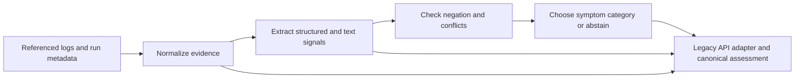

# OpsIntel classifier architecture

**Implementation:** `deterministic-signals-v2`  
**Scope:** deterministic incident symptom classification and evidence assessment.  
**Confirmation policy:** root causes remain unconfirmed by automation. The approved reviewer workflow and class-specific verification criteria have not been empirically validated.

## Flow

The implementation is in `app/classification.py`. `app/investigator.py` supplies run metadata and source references; `app/main.py` retains the established investigation and root-cause response fields while adding canonical assessment fields. Exasol queries and its integration are unchanged.

## Input and normalization

`classify_incident(evidence_items, context)` accepts a sequence of evidence mappings or strings plus optional run-scoped context. Evidence mappings can include `reference`, `source`, `timestamp`/`observed_at`, `observation`/`message`/`text`, `run_id`, and structured `fields` such as row counts, exit state, dependency state, schema types, and scheduled/actual timestamps.

Normalization retains each original mapping and raw observation, adds whitespace/case-normalized text for matching, retains the original timestamp, and adds an ISO timestamp only when parsing succeeds. Numeric values and booleans are validated before use. Malformed values remain in the original record, are excluded from signal decisions, and appear in `normalization_errors`. No evidence reference is synthesized by the classifier. A reference is traceable only when it came from an explicit reference or source plus a source record ID.

## Signal extraction and decisions

Signals are extracted from structured counts, typed fields, timestamps, exit/dependency state, and bounded text patterns. Every signal includes its category, value, polarity, method, strength, source/timestamp, and evidence references. Text parsing yields symptom evidence, not a causal conclusion.

Supported categories are `delayed_run`, `duplicate_data`, `timeout`, `schema_mismatch`, `dependency_failure`, `early_termination`, and `incomplete_data`. `excess_rows` is retained as a non-classifying signal: excess alone does not establish duplication. Time-based delay requires a declared threshold for structured timestamps; explicit schedule text can support a delay symptom. Comparable count shortfall supports incomplete data.

Independent positive symptoms are retained. When more than one category is supported, evidence strength and distinct source references select a primary category; the documented `CATEGORY_ORDER` is the deterministic final tie-breaker. Other categories appear in `secondary_categories`. This ordering is a compatibility/consistency rule, not a causal precedence claim.

Negated signals are recorded. A category supported and negated within the same incident creates a polarity conflict. Conflicting terminal states are compared only within a run scope, and differing actual counts conflict only within a shared scope. A conflict blocks a reliable category decision and yields legacy `conflicting_evidence` with canonical `resolution_status=unresolved`. A supported symptom with no supported causal hypothesis can still be `candidate_only`; no causal candidate is invented.

## Output contracts and compatibility

The legacy `classify_evidence(...)` function still returns `(category, hypothesis, recommended_action)`. Existing investigation fields remain present, including `category`, `hypothesis`, `confidence`, `matched_categories`, `tie_break_reason`, `recommended_action`, `evidence`, `root_causes`, and `comparison`.

The additive `classification` object includes:

- `version`, `symptom_category`, `secondary_categories`, and `status` (`supported` or `unresolved`)
- `resolution_status` (`candidate_only` or `unresolved`)
- `evidence_strength`, traceable `signals`, `conflicts`, and `normalization_errors`
- `unresolved_reason` and `confirmed_root_cause` (always `null` from the classifier)

`evidence_assessment` separately reports evidence status, references, untraceable item count, conflicts, and normalization errors. `causal_assessment` remains separate from classification; `incident_lifecycle` is `not_assessed`. The legacy root-cause assessor keeps its `candidates_only` output for consumers. New classifier fields use `candidate_only`; neither status means the incident is solved. Cause candidates are only emitted with source-backed evidence. The classifier, optional LLM, and investigator endpoint do not confirm causes.

The legacy category `conflicting_evidence` remains available to API consumers. In the canonical model, it is conflict state in `classification.conflicts` and evidence assessment, with no selected symptom when conflict blocks a decision. Legacy `unclassified` maps to canonical `symptom_category=null` and `resolution_status=unresolved`.

## Confirmation boundary

The approved design requires predefined cause-specific criteria and traceable evidence. Automation may propose candidate explanations but cannot confirm them. An investigator may submit a hypothesis; an authorized reviewer must review cited evidence and record decision, rationale, identity, and timestamp. Human approval cannot override absent or contradictory evidence. This release does not implement a confirmation workflow or treat any criteria as empirically validated.

## Known limits

- The text extractor is a small deterministic set of patterns, not a general log parser. Novel formats and complex clause scope can be missed.
- Conflict checks cover explicit disagreement, scoped terminal states, row counts, and opposing signal polarity; they do not reconcile all possible source/time scopes.
- Classification is a symptom-level heuristic. A source-reported mechanism is not an OpsIntel-confirmed root cause.
- The legacy causal candidate assessor remains rule-based. Missing provenance suppresses its candidate evidence rather than assigning synthetic `EVIDENCE-{index}` references.
- The two-case public V2 corpus supports development checks only; its Cloudflare category is provisional and its Slack case is an abstention boundary.
- The classifier has no participant-study evidence and has not been shown to improve investigation time or engineer outcomes.
