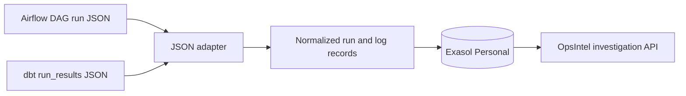

# Airflow and dbt JSON adapters

OpsIntel can normalize exported Airflow DAG-run records or dbt `run_results`
records before loading them into the same Exasol evidence tables used by the
dashboard.



Preview the normalized records without changing the database:

```bash
python -m scripts.import_orchestrator_json airflow examples/integrations/airflow_dag_runs.json
python -m scripts.import_orchestrator_json dbt examples/integrations/dbt_run_results.json
```

Add `--apply` only after reviewing the output. Each input record must provide a
numeric `opsintel_run_id` or `opsintel.run_id` so retries cannot silently create
new identities. The adapter demonstrates an integration boundary; it is not a
live Airflow or dbt connector.
