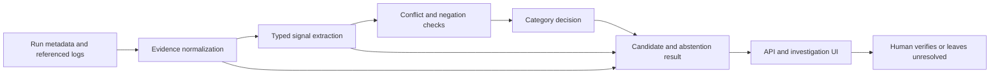

# Classifier architecture proposal v1

**Status: proposed; implementation is not approved.** This design follows the
classifier audit in [`classifier-error-analysis-v1.md`](classifier-error-analysis-v1.md).
It does not change the current classifier, frozen reviewer data, evaluation
rules, or reports.

## Goals and boundaries

- Recognize incident symptoms from both structured pipeline facts and varied
  log wording, without converting a symptom into a confirmed root cause.
- Preserve the source reference and timestamp for every normalized fact,
  extracted signal, and candidate explanation.
- Return `unresolved` when the evidence is absent, contradictory, negated, or
  too weak to support even a symptom category.
- Keep the classifier deterministic, inspectable, and small enough to debug.
- Continue to evaluate the existing category contract separately from reviewer
  uncertainty and evidence-quality measures.
- Tune only against a new, provenance-tracked development corpus. Keep
  `frozen_holdout_v1.csv`, `independent_holdout_v1.csv`, and their historical
  reports unchanged.

Out of scope: automatic repair or rerun, production root-cause confirmation,
LLM-led classification, and inferred operational facts that are absent from
the input.

## Proposed data flow

Each stage receives structured values and returns structured values. Raw
evidence remains available beside normalized text; no stage should replace the
original record with a paraphrase.

## Input contract

The classifier receives one incident plus an ordered collection of evidence
items. It must not fetch data or infer missing values itself.

| Field | Required | Meaning |
|---|---|---|
| `incident_id` | yes | Stable run or incident identifier |
| `pipeline_name` | no | Pipeline associated with the incident |
| `status` | no | Source-reported run state |
| `expected_rows`, `actual_rows`, `missing_rows` | no | Numeric source facts; counts remain `null` when unavailable |
| `scheduled_at`, `started_at`, `completed_at` | no | Source timestamps with timezone/precision retained |
| `evidence[]` | yes | Referenced observations or structured source facts |
| `evidence[].reference` | yes | Stable source record identifier |
| `evidence[].source` | yes | Table, log, validator, scheduler, or external record |
| `evidence[].kind` | yes | `log`, `row_count`, `timestamp`, `dependency`, `schema`, `status`, or `other` |
| `evidence[].observed_at` | no | Source timestamp, if supplied |
| `evidence[].text` | yes | Original text, not rewritten |
| `evidence[].fields` | no | Typed facts supplied by the source adapter, such as column, type, key, or related run |

An adapter may populate typed fields from existing database columns or
well-defined exported formats. It must not manufacture a value from absent
data. Any extraction from text must retain the originating reference and
identify the extractor/version that produced it.

## Output contract

Keep the current API fields during the first migration. Add a versioned
`classification` object so clients can adopt the richer result without
breaking existing consumers.

| Field | Meaning |
|---|---|
| `category` | One primary symptom category: the existing eight categories or `unclassified` |
| `secondary_categories[]` | Other independently supported symptoms, if present |
| `resolution_status` | `candidate_only` or `unresolved` |
| `signals[]` | Typed signal, value, polarity, method, and supporting evidence references |
| `candidates[]` | Possible explanations with supporting and contradicting references, plus next diagnostic action |
| `unresolved_reason` | Why the system abstained or why the underlying cause remains unverified |
| `confirmed_root_cause` | Always `null`; confirmation remains a human action outside the classifier |
| `classifier_version` | Explicit rule/extractor configuration version |

The existing tuple can remain as a compatibility adapter while callers migrate.
It must not be the canonical contract because it cannot carry evidence
references, multiple signals, or abstention separately from category.

## Component responsibilities and decision rules

### 1. Evidence normalization

- Validate required identifiers and preserve input order, raw text, source,
  timestamp, and structured fields.
- Normalize case and whitespace only for matching; retain the original string
  for display and audit.
- Do not discard a whole message because one clause looks benign. Negation and
  scope are handled at the signal level and each resulting signal points back
  to its original evidence reference.
- Missing or malformed fields remain explicitly missing and are reported as
  such; they are not defaulted to zero or an invented timestamp.

### 2. Signal extraction

Extract only observable symptoms, not causes:

- **Completeness:** expected/actual/missing counts and their arithmetic
  relationship, when counts are supplied or parsed by a deterministic,
  validated source adapter.
- **Timeout:** explicit timeout event, configured limit, or cancellation
  attributed by the source to that limit.
- **Schema:** explicit source/target type or format incompatibility, including
  named field/type details when available.
- **Dependency:** explicit upstream relation, prerequisite, task, or artifact
  state tied to the current run.
- **Early termination:** termination/abort event before a completion marker or
  expected completion state.
- **Delay:** explicit late-start/SLA signal, or comparable scheduled and actual
  start timestamps with a declared threshold. A positive difference alone is
  not a delay diagnosis when no threshold or SLA is provided.
- **Duplicates/excess:** duplicate-key evidence or source-reported excess
  count. Excess rows without key evidence remain an excess symptom, not proof
  of duplicate records.
- **Conflict:** two referenced claims about the same run/metric/state that
  cannot both be true, such as different row counts or incompatible terminal
  states.

Each signal records `type`, normalized `value`, `polarity` (`supports`,
`negates`, or `conflicts`), extraction method, and one or more evidence
references. Derived signals record their input references and derivation.

### 3. Category decision and abstention

1. Detect explicit contradictions first. Return `conflicting_evidence` with
   `resolution_status=unresolved`; preserve both sides and their references.
   Do not let a conflict erase non-conflicting symptoms that can be reported
   separately.
2. Otherwise, determine the primary symptom from direct structured signals
   before text-only matches. If several distinct symptoms are supported,
   return the strongest primary category and expose the others as secondary;
   do not silently hide them through list order.
3. A category requires at least one positive, non-negated signal. Text-only
   synonyms can support a category but remain distinguishable from structured
   source facts in the output.
4. If evidence only negates a signal, sources disagree, required comparison
   fields are missing, or no category has adequate support, return
   `unclassified` and `resolution_status=unresolved` with a specific reason.
5. If a symptom is supported but its cause is not, return the symptom category
   with `resolution_status=candidate_only`. Missing resource metrics, query
   plans, deployment history, or upstream logs constrain cause claims; they do
   not erase an observed timeout, count shortfall, invalid type, or late start.
6. `confirmed_root_cause` remains `null` in all classifier outputs. Candidate
   explanations must state the evidence references that support them and the
   missing checks needed to distinguish alternatives.

This separates two questions that the current exact-category result conflates:
“What symptom is supported?” and “Is there enough evidence to propose a
candidate explanation?” A conflict can therefore be categorized while its
resolution stays unresolved.

## Acceptance criteria for implementation

Implementation should not begin until this proposal is approved and a separate
development corpus is ready. The revised classifier should then meet all of
these criteria:

1. Existing function callers and API responses remain compatible during the
   migration, or an explicitly versioned breaking change is approved.
2. Every non-`unclassified` category has positive, paraphrased, negated, and
   misleading-text regression cases in the development tests.
3. Every extracted or derived signal and every candidate has valid supporting
   evidence references; contradictions also retain references to both sides.
4. A symptom with an unknown cause remains `candidate_only`; absence of a
   symptom signal remains `unresolved`; explicit contradiction is categorized
   as `conflicting_evidence` and remains unresolved.
5. Multiple supported symptoms are visible; deterministic selection does not
   depend on incidental rule-list order.
6. Structured counts, timestamps, types, and dependency relations are only
   used when supplied or parsed by a tested, provenance-preserving adapter.
7. Frozen synthetic and reviewer reports remain byte-for-byte unchanged.
8. Evaluation reports category accuracy, per-category precision/recall,
   confusion matrix, expected-vs-predicted uncertainty, and unresolved rate.
   It validates evidence linkage and causation wording instead of setting those
   outcomes as constants.
9. A new independently labelled holdout is collected and frozen before
   evaluation; development cases and public compatibility cases are not reused
   as that holdout.
10. No result is described as production accuracy or user impact without
    evidence from representative production data or the approved participant
    study.

## Trade-offs and risks

- Typed source fields improve accuracy and explainability, but source adapters
  must be maintained as upstream formats change. Keep the text-signal fallback
  for logs that do not expose structured fields.
- Reporting secondary symptoms avoids false certainty from precedence, at the
  cost of a richer response object and UI changes. Preserve the old primary
  `category` field during migration.
- A conservative conflict rule can increase unresolved results when references
  cannot be reconciled. This is preferable to choosing one contradictory value
  without evidence; the UI should show the conflict and the exact missing
  reconciliation step.
- A text-only synonym rule is cheap but can match irrelevant or negated prose.
  Add it only with positive, negative, and misleading-message examples in the
  development corpus.
- Exact-category accuracy remains useful for comparison but does not measure
  candidate quality, evidence support, or investigation usefulness. Keep those
  as separate metrics and validate usefulness with the participant study.

## Approval gate

Please approve or request changes to this proposal before classifier code,
evaluation code, or source adapters are changed. After approval, Phase 3 will
build a separate public, provenance-tracked development corpus; the frozen
reviewer holdout will remain excluded from tuning.
